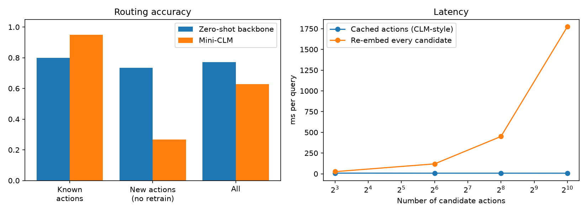

# Mini-CLM: a contrastive intent router for customer support

A small re-implementation of the core idea from **"Contrastive Language Models"** (Kwok et al., Stanford / NVIDIA, 2026): instead of *generating* an answer, **score candidate actions against a state** and pick the best one.

> This is an educational mini-version, not the official CLM-8B model. Original write-up: https://contrastive-lm.notion.site/ - Official code: https://github.com/Contrastive-LM/CLM

## What it does

A customer message (the **state**) is routed to a support workflow (the **action**), e.g. *refund*, *track order*, *reset password*.

```
message ──► frozen text encoder ─► state head ──┐
                                                 ├─► cosine similarity ─► best action
action text ─► frozen text encoder ─► action head ┘   (action embeddings are CACHED)
```

* **Two encoders**, each = frozen sentence-embedding backbone (`all-MiniLM-L6-v2`) + a small trainable projection head.
* **Bidirectional InfoNCE** loss pulls each message toward its correct action and pushes it away from the others. Messages that share an intent are masked out as false negatives inside a batch.
* **Action caching:** action embeddings are computed once. At inference only the message is embedded, then compared with the cache.
* **New actions without retraining:** add a new action by writing a sentence describing it.

## Run it

```bash
pip install -r requirements.txt
python mini_clm.py                  # trains, evaluates, benchmarks, writes artifacts/
python mini_clm.py --backbone tfidf # offline fallback if you can't download MiniLM
```

Try the router, including an action it was never trained on:

```bash
python mini_clm.py --demo "I was charged twice for one order"
python mini_clm.py --demo "my card got declined at checkout" \
    --add-action "Customer reports a failed or declined payment"
```

Outputs land in `artifacts/`: `results.md`, `results.json`, `results.png`, and model weights.

## What gets evaluated

| Test | Question it answers |
|---|---|
| Known actions, **unseen wording** | Does it generalise beyond the exact action text it trained on? |
| **New actions at inference** | Two intents are held out of training entirely. Can it route to them using only their description? |
| Zero-shot backbone baseline | Does training the heads actually help versus raw embedding similarity? |
| Latency, cached vs re-embedding all candidates | Does caching help as the candidate list grows? |

# Results (backbone: `minilm`)

Held-out intents (never seen in training): `talk_to_human, update_payment_method`

| Setting | Zero-shot backbone | Trained mini-CLM |
|---|---|---|
| Known actions (unseen wording of the action) | 80.0% | 95.0% |
| New actions added at inference, no retraining (only the new-intent messages) | 73.3% | 26.7% |
| All actions, all test messages | 77.1% | 62.9% |

## Latency per query (CPU, ms)

| Candidates | Cached action embeddings | Re-embed every candidate |
|---|---|---|
| 8 | 8.1 | 26.1 (3.2x slower) |
| 64 | 7.3 | 119.7 (16.3x slower) |
| 256 | 7.4 | 450.3 (60.9x slower) |
| 1024 | 7.1 | 1774.3 (250.2x slower) |

Final training loss: 0.000. Seeds fixed; small toy dataset, so treat numbers as a demo, not a benchmark.



## Honest limitations

* **Tiny, hand-written dataset** (10 intents, 150 messages). Numbers are a demo, not a benchmark.
* Only two intents are held out, so the "new action" result is noisy. Try `--holdout` with different intents and several seeds.
* The latency comparison is *cached vs re-embedding candidates with the same encoder*. It is **not** a comparison against a generative LLM.
* The official CLM trains on tens of millions of pairs. Here, the action side sees very few distinct descriptions, so generalising to new wording is limited.

## Ideas for extending it

1. Swap the toy data for **Banking77** (77 real intents) using the `datasets` library.
2. Add **hard negatives** (confusable intents, e.g. refund vs billing dispute), then compare training with and without a pre-training stage.
3. Add confidence thresholding that routes low-confidence messages to a human.
4. Wrap it in a small FastAPI or Gradio demo.
